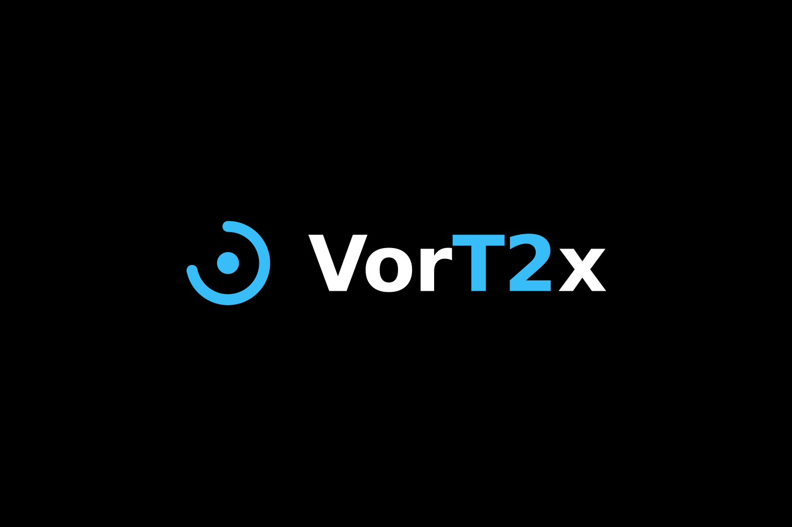

<p align="center">
  
</p>

# VorT2x

VorT2x (pronounced "vortex") brings T2 Mac support to stock Fedora using DKMS
modules. You keep getting kernel updates straight from Fedora, and the T2
modules, apps and fixes come from VorT2x.

[Website](https://vort2x.org) |
[Install](#install) |
[Contributing](#contributing) |
[License](#license)

> **Status:** v0.2.0 is the first VorT2x release. It supports Fedora 45 and
> hasn't been tested on a Mac under the VorT2x name yet. Expect rough edges.

## Install

VorT2x is an installer. You run it once on macOS to make a Fedora USB stick,
then Fedora finishes the setup by itself after the first login.

1. On a Mac, in macOS, connect an empty USB drive and run:

   ```bash
   curl -fsSL https://github.com/vorT2x-linux/vort2x/releases/latest/download/install-vort2x-fedora.sh | bash
   ```

   Pick a Fedora edition and the USB drive. It downloads and checks Fedora,
   then asks before it erases the drive.
2. Boot the Mac from the USB stick and install Fedora as usual.
3. After the first login, connect to Wi-Fi. The VorT2x installer opens, asks
   for one reboot, then installs the rest.

Run `vort2x-install` at any time later to update to the newest VorT2x
release for your Fedora version. [auto-installer/README.md](auto-installer/README.md)
has the details, rescue tools and troubleshooting.

## Contributing

Contributions are welcome. Please open an issue or a pull request, and keep
each change focused on one thing. Fixes that move T2 support closer to clean
upstream Linux support are especially welcome.

## Origin

VorT2x is a fork of [KAIT2EN](https://github.com/kaiT2en/KaiT2en-Fedora),
taken on 2026-11-17. It is an independent project and is not affiliated with
or endorsed by KAIT2EN. [NOTICE](NOTICE) and [AUTHORS](AUTHORS) list the
original authors, whose credit the licence requires to be kept.

## License

The kernel modules are GPL-2.0. Everything else, apps, protocols, audio DSP
profiles, scripts, howto documents and project text, is GPL-3.0-or-later.
Vendored third-party code keeps its upstream license. The full breakdown is in
[LICENSING.md](LICENSING.md).

What the project stands for is in [VALUES.md](VALUES.md).
